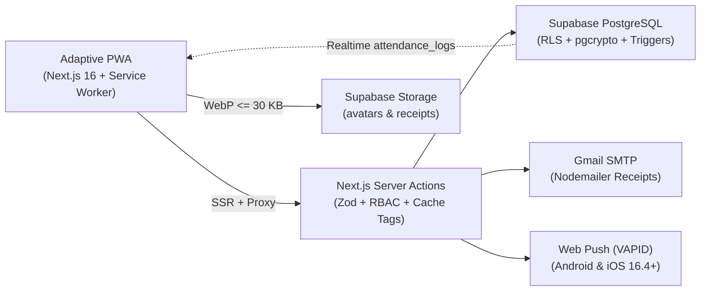

# SYCC Youth Growth & Discipleship Monitoring System


A zero-budget (**₱0.00/month**) church youth discipleship, Saturday attendance, encrypted pastoral cell-care, and Philippine Peso (PHP) treasury liquidation **Progressive Web App (PWA)** designed around a relational *"disciple-making-disciples"* vision.

> **Core Philosophy:** Never grade spirituality with percentages. Track observable milestones, unbroken Saturday fellowship streaks, ministry involvement, spiritual genealogy, and faithful stewardship.

---

## Table of Contents

- [Adaptive Device UX & Youth Portal](#adaptive-device-ux--youth-portal)
- [Role-Based Access Control (RBAC) Matrix](#role-based-access-control-rbac-matrix)
- [Domain Business Logic & Visual Palette](#domain-business-logic--visual-palette)
- [Architecture & Zero-Budget Engineering](#architecture--zero-budget-engineering)
- [Tech Stack](#tech-stack)
- [Project Structure](#project-structure)
- [Getting Started (Local & Supabase Setup)](#getting-started-local--supabase-setup)
- [Deploying to Vercel (₱0/month)](#deploying-to-vercel-0month)
- [Scripts & Quality Verification](#scripts--quality-verification)

---

## Adaptive Device UX & Youth Portal

The web application adapts dynamically across phones, tablets, and laptops based on both screen size and user role:

- **Youth-Focused Adaptive Login (`/login`):**
  - **Laptop / Desktop (`>= 1024px`):** Full-viewport 12-column split-screen layout pairing a Seasonal Theme showcase (Anchor Scripture glass card + interactive bento preview of Offline QR Pass, Saturday Streaks, and Family Tree) with a clean Sign In / Create Account workspace.
  - **Mobile & Tablet (`< 1024px`):** Curved vibrant seasonal hero header with a native-feeling elevated bottom sheet rising over it, `48px` touch-friendly inputs, password visibility toggle, walk-in streak auto-claim notice, and a 1-tap shortcut to cached offline QR passes.
- **Role-Adaptive App Shell:**
  - **`member` & `cell_leader` (Mobile-First `< 768px`):** Fixed Bottom Navigation Bar (`44x44px+` touch targets) with a floating center **My QR Pass** button, mobile bottom `Sheet` drawers, and horizontal top navigation on wider viewports.
  - **`registrar`, `treasurer`, `pastor`, `system_admin` (Laptop Split-Screen `>= 1024px`):** Left Navigation Sidebar paired with wide operational split-screen panes (plus a responsive slide-out menu drawer on mobile/tablet).

---

## Role-Based Access Control (RBAC) Matrix

Access is enforced at **three independent layers**: UI icon isolation (`src/lib/rbac.ts`), Next.js 16 Proxy (`src/proxy.ts`), and PostgreSQL Row-Level Security (`supabase/migrations/0003_rls_policies_realtime_seed.sql`). Unauthorized routes and icons are never rendered.

| Role (`public.app_role`) | Primary Layout | Accessible Modules | Privacy & Isolation Guarantees |
|---|---|---|---|
| **`member`** | Mobile-First (`< 768px`) | Home, Offline QR Pass, Personal Discipleship Tree, Koinonia Prayer & Events, Profile & Private Giving History | Sees only own profile, personal invite tree, and own giving records. |
| **`cell_leader`** | Mobile-First (`< 768px`) | All Member modules + **My Cell** (Umbrella Roster, Retention Radar, `pgcrypto` Encrypted Care Vault, Cell Meetup Scheduler & RSVP) | Cannot view other leaders' care notes or any member's tithes except their own. |
| **`registrar`** | Laptop Split-Screen (`>= 1024px`) | Pastel Hierarchy Check-In Roster, Webcam QR Scanner, Walk-In Registration, Attendance PDF Reports | Zero access to Care Vault or Treasury tables. |
| **`treasurer`** | Laptop Split-Screen (`>= 1024px`) | Realtime "Present Today" Giver Sync, PHP Bill/Coin Counter, Petty Cash Deductions, 2-Counter PIN Lock + Automated Receipts, Liquidation PDF Reports | Zero access to Care Vault or attendance check-in mutations. |
| **`pastor`** | Laptop / Mobile | Ministry Overview, Recursive Umbrella Cell Health, Masked Financial Summary, Church Events + Push Broadcast, Global Discipleship Tree, Seasonal Theme Studio, Pastor PDF Reports | Individual tithes and Cell Leader Care Vault notes remain strictly masked. |
| **`system_admin`** | Laptop / Mobile | Full root access (`public.is_system_admin()`), Audited Overrides, Leader Graduation, Emergency Sheet Unlock, Seasonal Theme Studio, `system_audit_logs` | Every manual override requires a mandatory reason and writes an immutable entry to `system_audit_logs`. |

---

## Domain Business Logic & Visual Palette

### 1. Soft Pastel Light Mode Hierarchy Palette
Attendance and roster views strictly use light-mode pastel rows (never dark row backgrounds, and never the label `"Sub-Leader"` — all shepherds are titled **Cell Leader**):

| Tier & Hierarchy | Background | Text Style | Display Label |
|---|---|---|---|
| **Top-Level Cell Leader** (`tier = 'cell_leader'`, `current_leader_id IS NULL`) | `#DBEAFE` (Soft Sky Blue) | `#1E3A8A` (Bold Deep Navy) | `Cell Leader` |
| **Emerging Cell Leader** (`tier = 'cell_leader'`, `current_leader_id IS NOT NULL`) | `#DCFCE7` (Light Mint Green) | `#14532D` (Bold Forest Green) | `Cell Leader` |
| **Consistent Disciple** (`tier = 'disciple'`) | `#F1F5F9` (Soft Slate) | `#334155` (Regular Dark Slate) | `Disciple` |
| **Regular Invite** (`tier = 'invite'`) | `#FFFFFF` (Pure White) | `#374151` (Regular Charcoal) | `Invite` |
| **New Invite** (`tier = 'new_invite'`) | `#FEF9C3` (Light Butter Yellow) | `#854D0E` (Italic Warm Amber) | `New Invite` |

### 2. Automated Consecutive Saturday Streak Progression
Computed automatically in PostgreSQL (`recalculate_attendance_streak`) on every check-in using `Asia/Manila` (`UTC+8`) Saturday dates:
- **< 4 consecutive Saturdays:** `new_invite`
- **4 consecutive Saturdays (1 month unbroken):** Auto-upgrades `new_invite` -> `invite` *(if a streak breaks before 8 weeks, the member remains `invite` and never downgrades back to `new_invite`)*
- **8 consecutive Saturdays (2 months unbroken):** Auto-upgrades -> `disciple`
- **`cell_leader` & `alumni`:** Immune to automated streak-based tier changes.

### 3. Dual Hierarchy & Leader Graduation
Every row in `public.profiles` maintains two distinct relationship pointers:
1. **`invited_by_id`:** Permanent spiritual genealogy (protected by trigger; powers the `@xyflow/react` Discipleship Family Tree).
2. **`current_leader_id`:** Active cell shepherd (powers `WITH RECURSIVE` umbrella cell counts and updates during Cell Multiplication or Leader Graduation).

When a Cell Leader graduates via `graduate_cell_leader`, their tier becomes `alumni`, their direct cell members' `current_leader_id` moves to the incoming leader, all old encrypted `care_notes` are archived (`is_archived = TRUE`) so the incoming leader starts with a fresh private vault, and the event is logged to `system_audit_logs`.

### 4. Treasury & Philippine Peso (PHP) Liquidation
- **Live Registration Sync:** Subscribes to `public.attendance_logs` via Supabase Realtime so checked-in youth appear immediately on the Treasurer's "Present Today" giver roster.
- **Physical Denomination Counter:** Tracks `₱1,000`, `₱500`, `₱200`, `₱100`, `₱50`, `₱20`, `₱10`, `₱5`, and `₱1` via a PostgreSQL generated column (`actual_physical_cash`), reconciled against `expected_cash_total` (excluding `gcash_ewallet`).
- **Net Turn-Over & 2-Counter PIN Lock:** Deducts Saturday petty cash expenses (`Gross Physical Cash - Expenses = Net Turn-Over`) and requires two distinct counters to verify bcrypt-hashed PINs (`is_locked = TRUE`) before dispatching automated Gmail HTML giving receipts and Web Push alerts.

### 5. Dynamic Seasonal Theme Studio
Active season branding (`season_title`, `anchor_verse`, `verse_reference`, `primary_color`, `accent_color`, `banner_gradient`) is loaded from `app_theme_settings` with Next.js 16 `'use cache'` (`cacheTag('theme')`) and injected into `:root` CSS custom properties (`--color-primary`, `--color-accent`, `--banner-gradient`). Publishing a new theme calls `updateTag('theme')` for instant zero-redeploy updates across all devices.

---

## Architecture & Zero-Budget Engineering



### Built-In Free-Tier Guardrails (Vercel Hobby + Supabase Free Tier)
- **0 KB QR Storage:** Weekly QR passes (`SYCC:${profileId}:${YYYY-MM-DD}`) render client-side with `qrcode.react` and cache the user identity locally for zero-signal check-ins.
- **Strict Image Compression:** Every avatar and petty cash receipt upload is compressed client-side with `browser-image-compression` (`maxSizeMB: 0.03`, `maxWidthOrHeight: 400`, `image/webp`) and backed by 50 KB Supabase Storage bucket policies.
- **Browser-Side PDFs:** Attendance, Liquidation, and Pastor PDF reports generate locally in the browser using `@react-pdf/renderer` (zero serverless timeout or memory overhead).
- **Encrypted Pastoral Confidences:** `care_notes.encrypted_note` is encrypted/decrypted strictly server-side using PostgreSQL `pgcrypto` (`pgp_sym_encrypt` / `pgp_sym_decrypt`) with a server-only `CARE_VAULT_ENCRYPTION_KEY`.

---

## Tech Stack

| Category | Technology |
|---|---|
| **Framework** | Next.js `16.4.6` (App Router, Turbopack, `cacheComponents`, `partialPrefetching`, `useOffline`, `src/proxy.ts`), React `19.3`, TypeScript `5` (Strict) |
| **Styling & UI** | Tailwind CSS `4.3` (`@tailwindcss/turbopack`), `radix-ui` (`shadcn/ui` primitives), `lucide-react`, `sonner` |
| **Database & Auth** | Supabase (`@supabase/supabase-js`, `@supabase/ssr`) — PostgreSQL, Auth, Realtime, Storage, RLS, `pgcrypto`, `pg_trgm` |
| **Validation** | `zod` + typed `ActionResult<T>` Server Actions |
| **PWA & Offline** | `src/app/manifest.ts`, `public/sw.js` (App Shell + `/qr-pass` offline cache + Push handlers), `serwist`, Next.js `useOffline()` |
| **QR, Tree & PDF** | `qrcode.react`, `@yudiel/react-qr-scanner`, `@xyflow/react`, `@react-pdf/renderer` |
| **Media & Alerts** | `browser-image-compression`, `web-push` (VAPID), `nodemailer` (Gmail SMTP App Password) |

---

## Project Structure

```text
sycc-system/
├── public/
│   ├── icons/                   # PWA manifest PNG icons (192x192, 512x512)
│   └── sw.js                    # Service Worker (offline shell, /qr-pass cache, Web Push)
├── supabase/
│   ├── migrations/
│   │   ├── 0001_schema_core.sql
│   │   ├── 0002_functions_triggers_streaks.sql
│   │   └── 0003_rls_policies_realtime_seed.sql
│   └── verify_rls_and_streaks.sql
└── src/
    ├── proxy.ts                 # Next.js 16 Proxy (session refresh + RBAC route guard)
    ├── actions/                 # Zod-validated Server Actions (auth, attendance, treasury, care, koinonia, events, profile, push, admin)
    ├── app/
    │   ├── layout.tsx           # Root layout injecting cached Seasonal Theme CSS variables
    │   ├── globals.css          # Tailwind v4 light-mode theme + animations
    │   ├── manifest.ts          # Standalone PWA manifest
    │   ├── (auth)/login/        # Adaptive youth login (Laptop split-screen + Mobile sheet)
    │   └── (dashboard)/
    │       ├── layout.tsx       # Role-aware shell (MobileBottomNav vs LaptopSidebar)
    │       ├── page.tsx         # Seasonal Theme Hero + Saturday streak milestones
    │       ├── qr-pass/         # Offline weekly QR pass
    │       ├── tree/            # Interactive Discipleship Family Tree (@xyflow/react)
    │       ├── koinonia/        # Prayer Wall & Church Events RSVP
    │       ├── profile/         # Bio, WebP avatar, private giving history & push setup
    │       ├── cell-care/       # Cell Leader Roster, Radar, Encrypted Care Vault & Meetups
    │       ├── registrar/       # Laptop split-screen check-in, QR scanner & walk-ins
    │       ├── treasurer/       # Laptop live giver sync, PHP counter & 2-Counter PIN lock
    │       ├── pastor/          # Ministry overview, masked finances, events & Theme Studio
    │       └── admin/           # Audited overrides, Leader Graduation, Theme Studio & logs
    ├── components/              # ui/, auth/, navigation/, providers/, pwa/, qr/, tree/, koinonia/, profile/, cell/, registrar/, treasurer/, pastor/, admin/, reports/
    ├── lib/                     # supabase/*, auth.ts, rbac.ts, hierarchy-styles.ts, format.ts, image-compress.ts, theme.ts, mailer.ts, push.ts
    └── types/database.types.ts  # Strict PostgreSQL & RPC TypeScript definitions
```

---

## Getting Started (Local & Supabase Setup)

### Prerequisites
- **Node.js 20+** and **npm**
- A free **[Supabase](https://supabase.com)** project (Singapore `ap-southeast-1` region recommended for low PH latency)
- A Gmail account with **2-Step Verification** enabled (to create a 16-character App Password for giving receipts)

### 1. Install Dependencies
```bash
git clone <your-github-repo-url>
cd sycc-system
npm install
```

### 2. Configure Environment Variables (`.env.local`)
Create `.env.local` in the **project root** (never inside `public/` — `.gitignore` automatically excludes `.env*`):

```env
# Supabase Project Settings -> API
NEXT_PUBLIC_SUPABASE_URL=https://<your-project-ref>.supabase.co
NEXT_PUBLIC_SUPABASE_ANON_KEY=<your-anon-key>
SUPABASE_SERVICE_ROLE_KEY=<your-service-role-key>

# Server-only 32-byte symmetric key for pgcrypto Care Vault encryption
# Generate with: node -e "console.log(require('crypto').randomBytes(32).toString('base64'))"
CARE_VAULT_ENCRYPTION_KEY=<your-32-byte-base64-secret>

# Web Push (VAPID)
# Generate with: npx web-push generate-vapid-keys
NEXT_PUBLIC_VAPID_PUBLIC_KEY=<your-vapid-public-key>
VAPID_PRIVATE_KEY=<your-vapid-private-key>
VAPID_SUBJECT=mailto:sycc-youth@yourdomain.org

# Gmail SMTP Transactional Giving Receipts
GMAIL_SMTP_USER=sycc-treasury@gmail.com
GMAIL_APP_PASSWORD=<16-char-google-app-password>

NEXT_PUBLIC_APP_URL=http://localhost:3000
```

> **Security Note:** Never expose `SUPABASE_SERVICE_ROLE_KEY`, `CARE_VAULT_ENCRYPTION_KEY`, `VAPID_PRIVATE_KEY`, or `GMAIL_APP_PASSWORD` to browser code (`'use client'`).

### 3. Run Supabase SQL Migrations
Open your Supabase Dashboard → **SQL Editor** and run these files in exact order:
1. `supabase/migrations/0001_schema_core.sql`
2. `supabase/migrations/0002_functions_triggers_streaks.sql`
3. `supabase/migrations/0003_rls_policies_realtime_seed.sql`

*(Optional)* Run `supabase/verify_rls_and_streaks.sql` in SQL Editor to verify the 4-week/8-week streak rules, `pgcrypto` encryption round-trip, and PHP denomination math inside a safe rolled-back transaction.

### 4. Bootstrap Your First `system_admin` Account
1. Start the dev server (`npm run dev`), visit `http://localhost:3000/login`, and sign up with your admin email.
2. Promote your account in the Supabase SQL Editor:
   ```sql
   UPDATE public.profiles
   SET role = 'system_admin', tier = 'cell_leader'
   WHERE lower(email) = lower('your-admin-email@example.com');
   ```
3. Sign out and sign back in — you will be routed directly to `/admin`, where you can assign `cell_leader`, `registrar`, `treasurer`, and `pastor` roles for your team.

### 5. Run Locally & Test Offline PWA
```bash
# Development server
npm run dev

# Production build (recommended for testing offline /qr-pass and Service Worker)
npm run build && npm run start
```
To verify offline QR check-in: load `/qr-pass` once while signed in, toggle **Offline** in Chrome DevTools → Network, and reload `/qr-pass`.

---

## Deploying to Vercel (₱0/month)

1. Push this repository to GitHub.
2. Import the repository into **[Vercel](https://vercel.com)** (Hobby Free Tier).
3. Add all environment variables from `.env.local` in **Project Settings → Environment Variables** (update `NEXT_PUBLIC_APP_URL` to your production `https://...vercel.app` URL).
4. In Supabase **Authentication → URL Configuration**, set **Site URL** and **Redirect URLs** to your production Vercel URL.
5. Deploy! HTTPS is enabled automatically, unlocking standalone iOS 16.4+ / Android PWA home-screen installation and Web Push notifications.

---

## Scripts & Quality Verification

| Command | Purpose |
|---|---|
| `npm run dev` | Start Next.js 16 Turbopack development server |
| `npm run build` | Build production bundle and validate Cache Components & TypeScript |
| `npm run start` | Serve production build locally |
| `npm run lint` | Run ESLint (Next.js Core Web Vitals + TypeScript rules) |
| `npx tsc --noEmit` | Run strict TypeScript type check across the codebase |
